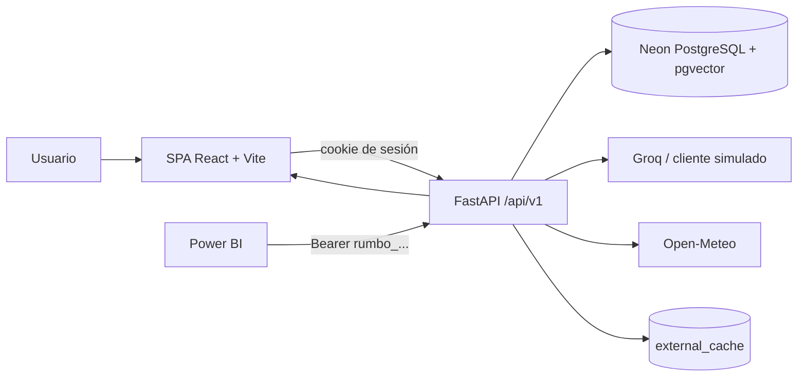

# Rumbo AI

Plataforma web de asistencia y planificación turística mediante inteligencia artificial. Incluye
un chatbot con RAG sobre un catálogo turístico propio, dos servicios de agentes multi-paso, control
de consumo de tokens, API REST documentada y reportes para la web y Power BI.

## Arquitectura



El frontend se compila con Vite y FastAPI sirve `web/dist`. En producción corre en un contenedor
Fly.io; la base de datos y los embeddings viven en Neon.

## Modelo de datos

| Tabla | Contenido |
| --- | --- |
| `users` | Cuentas, rol `admin`/`user`, estado y límite de tokens |
| `sessions` | Sesiones web con token hasheado y expiración |
| `api_tokens` | Tokens externos con alcance `read`/`write` |
| `destinations` | Destinos, intereses, coordenadas, temporada y embedding |
| `activities` | Actividades por destino, costo, duración y embedding |
| `ai_services` | Servicios de IA, modelo y prompt de sistema |
| `conversations` | Conversaciones por usuario y servicio |
| `messages` | Mensajes, fuentes citadas y tokens por mensaje |
| `ai_requests` | Auditoría de consumo, estado y latencia por llamada |
| `external_cache` | Respuestas externas cacheadas con TTL |

## Requisitos

- Python 3.12 y [uv](https://docs.astral.sh/uv/)
- Node.js 22 o superior
- Docker (para PostgreSQL local con `pgvector`)

## Instalación

```bash
uv sync
cp .env.example .env
docker compose up -d db
```

Edita `.env` y define al menos `DATABASE_URL` y `SESSION_SECRET`. La aplicación falla al iniciar si
falta `DATABASE_URL`.

| Variable | Obligatoria | Uso |
| --- | --- | --- |
| `DATABASE_URL` | Sí | PostgreSQL con `pgvector`; Neon en producción |
| `SESSION_SECRET` | Sí | Firma/validez de sesiones; mínimo 16 caracteres |
| `GROQ_API_KEY` | No | Si falta, desarrollo usa el cliente LLM simulado |
| `ENV` | No | `development`, `test` o `production`; afecta cookies seguras |

### Base de datos y datos de demostración

```bash
docker compose up -d db
uv run alembic upgrade head
uv run python -m scripts.seed
```

El seed es idempotente y crea usuarios de demostración:

| Rol | Correo | Contraseña |
| --- | --- | --- |
| admin | `admin@rumbo.ai` | `Admin123!` |
| user | `user@rumbo.ai` | `User123!` |

## Desarrollo

Backend con recarga automática:

```bash
uv run uvicorn app.main:app --reload
```

Frontend:

```bash
cd web
npm install
npm run dev
```

La web queda en `http://localhost:5173` y la API en `http://localhost:8000`.
Swagger está en `http://localhost:8000/api/docs` y el esquema OpenAPI en
`http://localhost:8000/api/openapi.json`.

### Autenticación y tokens externos

La web usa una cookie de sesión. Para consumidores externos (Postman, Power BI) se crea un token
con `POST /api/v1/auth/tokens` usando la sesión, con alcance `read` o `write`:

```bash
curl -c cookies.txt -X POST http://localhost:8000/api/v1/auth/login \
  -H 'Content-Type: application/json' \
  -d '{"email":"admin@rumbo.ai","password":"Admin123!"}'

curl -b cookies.txt -X POST http://localhost:8000/api/v1/auth/tokens \
  -H 'Content-Type: application/json' \
  -d '{"name":"power-bi","scope":"read"}'
```

El valor del token solo se devuelve al crearlo. Luego se envía con
`Authorization: Bearer rumbo_...`. Los tokens de solo lectura no pueden modificar datos.

El CRUD de usuarios está en `/api/v1/users` y requiere rol `admin`.

### Historial, consumo y cuotas

- `GET /api/v1/history/conversations`: historial propio; el admin puede filtrar por `user_id`.
- `GET /api/v1/history/conversations/{id}`: mensajes y fuentes de una conversación.
- `GET /api/v1/usage`: consultas y tokens por servicio, con filtros `user_id`, `service_id`,
  `date_from` y `date_to`. Devuelve el límite y los tokens restantes del usuario.
- `GET /api/v1/services`: servicios de IA activos.
- `POST /api/v1/ai/quota-check`: verifica la cuota antes de ejecutar una llamada; responde 429 con
  `code: quota_exceeded` cuando no alcanza.

Los usuarios normales solo ven sus propios datos; el admin puede consultar el uso global. Cada
solicitud bloqueada queda registrada con estado `blocked` y sin consumo de tokens.

### Chat con RAG

`POST /api/v1/chat` recibe `{ "message": "...", "conversation_id": null, "service_slug": "chatbot" }`.
La respuesta incluye el mensaje, las fuentes citadas (`sources`), los tokens usados y
`insufficient_context` cuando el catálogo no alcanza para responder.

La recuperación combina búsqueda full-text en español y similitud vectorial con `pgvector`. El seed
calcula los embeddings del catálogo. Si `GROQ_API_KEY` está vacía, en desarrollo se usa un cliente
LLM simulado; configura la clave para obtener respuestas reales. La conversación conserva memoria
por sesión y cada respuesta guarda sus fuentes en `messages.sources`.

### Agentes multi-paso

- `POST /api/v1/agents/itinerary`: planifica días, actividades, costo, clima y distancia desde un
  origen opcional.
- `POST /api/v1/agents/adjust`: recalcula el plan con `change: "rain"` o `change: "budget"` (más
  `new_budget`), indicando qué actividades reemplazó.

Ambos aceptan `destination_id` o `destination_query`, `days`, `interests`, `budget`, `travelers` y
coordenadas de origen. La respuesta incluye `itinerary`, `steps`, `sources`, `warnings` y
`missing_info`. El clima se consulta a Open-Meteo con caché de 30 minutos; si la fuente falla, el
plan se devuelve con la advertencia y sin inventar el dato.

### Errores uniformes

Todas las respuestas de error tienen la forma `{"code", "message", "details"}`:

| HTTP | `code` | Cuándo |
| --- | --- | --- |
| 400 | `bad_request` | Solicitud inválida para el estado actual |
| 401 | `unauthorized` | Sin sesión o token válido |
| 403 | `forbidden` | Rol o alcance insuficiente |
| 404 | `not_found` | Recurso inexistente |
| 409 | `conflict` | Correo duplicado |
| 422 | `validation_error` | Cuerpo o parámetros inválidos |
| 429 | `rate_limited` / `quota_exceeded` | Límite de tasa o tokens agotados |
| 500 | `internal_error` | Fallo no controlado |

### Límite de tasa

`/api/v1/chat`, `/api/v1/agents/*` y `/api/v1/ai/quota-check` permiten 60 solicitudes por minuto por
usuario, además de la cuota de tokens. El límite es en memoria y aplica a una sola instancia.

### Postman

La colección y el entorno están en `postman/`. Con el servidor levantado:

```bash
npx newman run postman/rumbo-ai.postman_collection.json \
  -e postman/rumbo-ai.postman_environment.json
```

La colección hace login, crea un token `write`, consulta servicios, chat, itinerario, historial y
consumo. Ajusta `adminEmail`, `adminPassword` y `baseUrl` en el entorno si hace falta.

### Reportes y Power BI

La página `/reports` y Power BI consumen el mismo endpoint:

```bash
curl -H "Authorization: Bearer $TOKEN" \
  "http://localhost:8000/api/v1/reports/usage?date_from=2026-11-01T00:00:00Z&date_to=2026-11-30T23:59:59Z&service_id=1"
```

Devuelve `rows` agrupadas por día UTC, servicio y usuario, más un objeto `totals` con consultas,
bloqueadas y tokens. Los reportes usan **UTC** para las fechas y **USD** para los costos.

La consulta M y la guía para crear el reporte forman parte del entregable local (carpeta `powerbi/`,
no versionada). El archivo `.pbix` se genera y guarda desde Power BI Desktop; este entorno no
incluye esa aplicación, por lo que se entregan la consulta y el procedimiento reproducible.

## Despliegue

- Aplicación: **https://rumbo-ai.fly.dev**
- Salud: `https://rumbo-ai.fly.dev/health`
- Swagger: `https://rumbo-ai.fly.dev/api/docs`
- Base de datos: Neon `rumbo-ai-db`, base `rumbo`, región `aws-us-east-2`.
- Fly.io: app `rumbo-ai`, región `ord`, configuración en `fly.toml`.

El despliegue automático está en `.github/workflows/ci-cd.yml`: ejecuta lint, tipos, build, migraciones
y pruebas, y solo despliega en `main` si todo pasa. Los secretos y el rollback se documentan en
`DEPLOY.md`. La app corre con `ENV=production`, `GROQ_API_KEY` configurada como secreto de Fly y el
modelo `openai/gpt-oss-20b`.

## Pruebas y verificación

```bash
uv run pytest
uv run ruff check .
uv run mypy app scripts
cd web && npm run typecheck && npm run build
```

Smoke test de extremo a extremo contra un entorno:

```bash
uv run python -m scripts.smoke_test --base-url https://rumbo-ai.fly.dev
```

Verifica login, catálogo, chat, agente, historial, reporte, consumo y logout; falla con código distinto
de cero si algún paso no responde o si las cifras del reporte no coinciden.

## Estructura

```
app/            API FastAPI, configuración, modelos, servicios e IA
migrations/     Migraciones Alembic (0001..0006)
scripts/        Seed y smoke test
tests/          Pruebas automatizadas con pytest
web/            Frontend React + TypeScript + Vite
postman/        Colección y entorno de Postman
powerbi/        Consulta M y guía del reporte (local, ignorado)
docs/           Evidencias, PDF y DOCX (local, ignorado)
openspec/       Planificación local (ignorada por Git)
```

## Estado

Fases 1–10 implementadas y desplegadas. Pendientes: el archivo `.pbix` de Power BI (8.4) y las
capturas de Power BI/CI remoto (10.3); ambos requieren Power BI Desktop y una ejecución real de
GitHub Actions. Los entregables PDF/DOCX y las evidencias se generan localmente en `docs/` (no
versionados). El plan completo vive en `openspec/changes/define-rumbo-ai-mvp/`.
